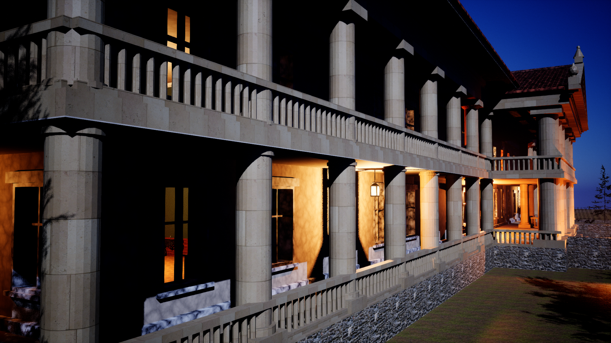
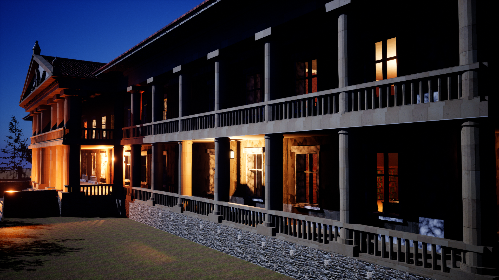
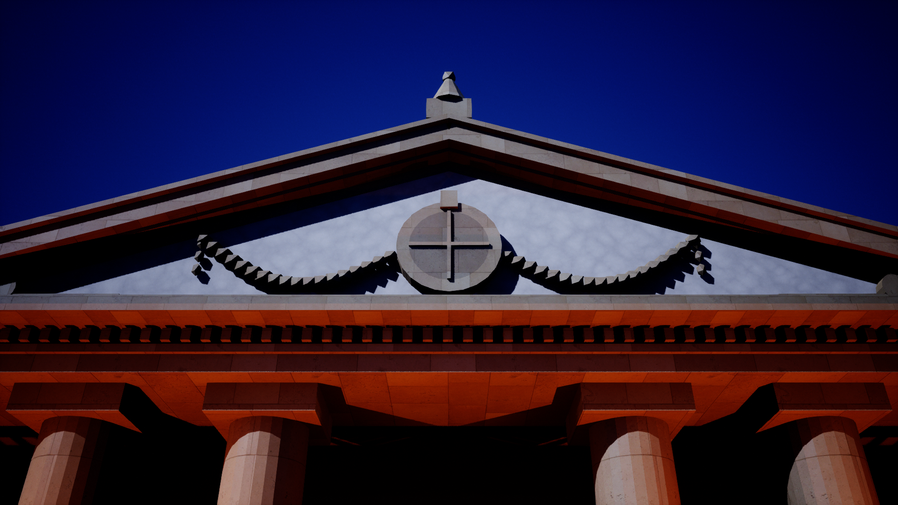

# Redwood Hollow – Harita Tasarımı
---------------------------------------------------------------------------------------------------------------------------------------
🇹🇷 Türkçe Açıklama

Bilgilendirme:

Bu harita, tamamen tek başıma, yapay zekayı bir rehber ve yardımcı araç olarak kullanarak kısıtlı boş zamanlarımda tasarlayıp geliştirmeye çalıştığım kişisel bir projedir. Yoğun bir üniversite sınavı (YKS) hazırlık sürecinde olduğum için zamanım oldukça kısıtlı; bu nedenle gözümden kaçmış olabilecek ufak hatalar veya eksiklikler için anlayış gösteren herkese şimdiden teşekkür ederim. Eğer gözden kaçırdığım büyük hatalar veya önemli sorunlar fark ederseniz lütfen beni bilgilendirin.

---------------------------------------------------------------------------------------------------------------------------------------
🇬🇧 English Description

Information:

This map is a personal project that I have been designing and developing entirely on my own in my limited spare time, using AI strictly as a guide and assisting tool. As I am currently preparing intensively for university entrance exams, my free time is very limited. Thank you in advance for your understanding regarding any minor bugs or oversights you might encounter. If you notice any major bugs or critical issues that I may have overlooked, please let me know.

---------------------------------------------------------------------------------------------------------------------------------------

## Proje / Project

🇹🇷 **Türkçe**

Kişisel bir harita tasarımı çalışması. Oyun değil; Unreal Engine 5.8'de gezilebilen, gece geçen bir malikane haritası.

Haritada şunlar var:
- Demir çitle çevrili büyük bir bahçe ve iki bahçe kapısı.
- Bahçeye dağılmış kulübeler, ağaçlar ve içinden geçilebilen çalılıklar.
- Ortada iki katlı sütunlu galeriyle çevrili, kiremit çatılı, saray gibi döşenmiş bir malikane.

Harita Blender'da Python ile üretiliyor ve Unreal Engine'e otomatik aktarılıyor. Haritayı gezerken kullanılan birkaç küçük etkileşim de var: kapı açma, çömelme ve dar aralıktan geçme.

🇬🇧 **English**

A personal map design project. It is not a game; it is a night-time mansion map you can walk around in Unreal Engine 5.8.

The map contains:
- A large garden enclosed by an iron fence, with two garden gates.
- Huts, trees and walk-through undergrowth scattered across the garden.
- In the middle, a palace-like mansion with a clay-tiled roof, surrounded by a two-storey colonnade.

The map is generated in Blender with Python and imported into Unreal Engine automatically. A few small interactions are available while exploring: opening doors, crouching and squeezing through a narrow gap.


| | |
|---|---|
|  |  |
|  |  |

---------------------------------------------------------------------------------------------------------------------------------------

## Haritayı gezmek / Exploring the map

🇹🇷 **Türkçe**

`Unreal/RedwoodHollow/RedwoodHollow.uproject` dosyasını aç ve **Play**'e bas. Kamera üçüncü şahıs, omuz üstünden. WASD ile yürünür, fareyle etrafa bakılır.

🇬🇧 **English**

Open `Unreal/RedwoodHollow/RedwoodHollow.uproject` and press **Play**. The camera is third person, over the shoulder. Walk with WASD and look around with the mouse.

---------------------------------------------------------------------------------------------------------------------------------------

## Mekanikler / Mechanics

🇹🇷 **Türkçe**

| Tuş | Mekanik | Nasıl çalışıyor |
|---|---|---|
| **Sol tık** | Kapı ve kapak açma | Baktığın kapıyı menteşesi üstünde yumuşakça açar ya da kapatır. Malikanenin ana kapısı, balkon kapısı, hol ve oda kapıları, kulübe kapıları ve yerdeki tahta kapaklar açılır. Çift kanatlı kapıların iki kanadı birlikte açılır. Kapının önünde mobilya olsa bile yakındaki kapıyı bulur. |
| **Ctrl** (basılı tut) | Çömelme | Karakter yavaşça çömelir, bırakınca yavaşça doğrulur; yürürken basınca doğrudan çömelerek yürümeye geçer. Çömelikken daha yavaş yürünür, kamera da alçalır. Yemek salonundaki uzun masanın ve çalışma masalarının altına girilebilir. Bir masanın altındayken Ctrl bırakılırsa, başının üstünde yer açılana kadar çömelik kalır. |
| **E** (basılı tut) | Dar aralıktan geçme | Dar bir aralığın önüne gelince ekranda beyaz daire içinde **E** belirir. E'ye 0,7 saniye basılı tutunca dairenin çevresindeki yeşil halka dolar ve karakter aralıktan yan yan geçer. |
| Sol tık + yer kapağı | Gizli tünel | Bir kulübenin zeminindeki tahta kapak açılınca merdivenle tünele inilir. Tünel çitin altından geçer ve bahçenin dışındaki ikinci bir kapaktan çıkar. |

🇬🇧 **English**

| Key | Mechanic | How it works |
|---|---|---|
| **Left click** | Doors and hatches | Smoothly swings the door you are looking at open or shut on its hinges. The main entrance, the balcony door, hall and room doors, hut doors and the wooden floor hatches all open. Both leaves of a double door open together. It still finds a nearby door when furniture stands in front of it. |
| **Ctrl** (hold) | Crouch | The character slowly crouches and slowly stands up again on release; pressing it while walking goes straight into a crouch walk. Crouched, you move slower and the camera drops. You can crawl under the long dining table and the desks. Releasing Ctrl under a table keeps you crouched until there is head room. |
| **E** (hold) | Squeeze through a gap | Near a narrow gap a white circle with **E** appears on screen. Holding E for 0.7 seconds fills the green ring around it and the character shuffles sideways through the gap. |
| Left click + floor hatch | Secret tunnel | Opening the wooden hatch in a hut floor leads down a stair into a tunnel. It runs under the fence and comes up through a second hatch outside the garden. |

---------------------------------------------------------------------------------------------------------------------------------------

## Harita / The map

🇹🇷 **Türkçe**

| Bölüm | İçerik |
|---|---|
| Bahçe | ~200 m × 110 m, 330 ağaç, 180 çalı, 260 öbekte ~5.700 eğreltiotu, alçak çalı ve uzun ot, 25.000 çimen öbeği, çakıl yollar. Çalıların ve otların içinden geçilebiliyor; karakter yaklaşınca kökünden ters yöne yatıyor, hafif rüzgârda da sallanıyorlar |
| Sınır | Taş kaide üstünde mızrak uçlu siyah demir çit, her ~14 m'de taş sütun |
| Bahçe kapıları | Batıda ve güneyde kemerli, çift kanatlı demir kapılar |
| Malikane | 44 m × 80 m, 2 kat, 1,5 m kaide. Büyük dış merdiven, 6 dev sütunlu giriş, balkon, krem badanalı sıva cephe, dört yana eğimli kiremit kaplı kırma çatı |
| Alınlık | Giriş sütunlarının üstünde klasik alınlık: profilli eğik ve yatay korniş, diş sırası, sıvalı iç yüzeyde göz pencere ve kabartma çelenkler, tepede ve köşelerde taş süslemeler |
| Sütunlu galeri | Malikaneyi dört yandan saran iki katlı galeri: altta mermer döşeli veranda, üstte korkuluklu balkon yolu, kaideli ve başlıklı dev sütunlar, tavana asılı demir fenerler, bahçeye inen üç merdiven. Çatı galeriyi de örtüyor |
| Giriş holü | İki kat yüksekliğinde, siyah-beyaz mermer zemin, kapının karşısında kırmızı halılı imparatorluk merdiveni, üst galeri, dev avize, ahşap lambri |
| İç mekân | Odalarda koyu ahşap lambri ve süpürgelik, üstünde ipek duvar kaplaması (kuzey kanat yeşil, güney kırmızı, doğu mavi), krem tavan, tavan pervazı ve avize göbekleri |
| Odalar | Holün iki yanındaki kanatlar her katta beşe bölünmüş: ön oda, yan oda, dış oda, giyinme odası ve banyo. Zemin kat: şömineli salon, sigara odası, yemek salonu, oturma odası. Üst kat: sayvanlı yataklı yatak odaları, çalışma odaları. Doğu kanadı üç bölüm: kütüphane ve portre galerisi. Odalar arası tek kanatlı kapılar açılıp kapanır |
| Banyolar | 4 banyo (her kanatta, iki katta): ayaklı küvet, zincirli rezervuarlı klozet, ayaklı lavabo ve ayna, karo zemin, koyu yeşil fayans lambri, küçük avize |
| Mobilya | Koltuk, kanepe, gotik yatak ve dolap, konsol, ayaklı saat, büst, ayna, tablo, şamdan; yemek ve çalışma masalarının altı çömelince girilecek yükseklikte |
| Işık | 31 avize, 11 galeri feneri, 7 şömine ateşi, her pencerede kadife perde, gece ay ışığı ve sis |
| Kulübeler | 7 kulübe: taş temel, kiremit kaplı saçaklı çatı, ahşap kalkan duvarı, camlı pencereler, açılır tahta kapı, içinde ahşap tezgahlar ve duvara sabit gaz lambaları |
| Gizli tünel | Bir kulübenin zeminindeki kapaktan inilen, çitin altından geçip dışarıda ikinci bir kapaktan çıkan ahşap destekli tünel |
| Dar aralık | Güney kanadın üst katında dolapların yarı kapattığı kapı; arasından yan yan geçiliyor |

🇬🇧 **English**

| Part | Contents |
|---|---|
| Garden | ~200 m × 110 m, 330 trees, 180 bushes, ~5,700 ferns, low shrubs and tall grass in 260 patches, 25,000 grass tufts, gravel paths. You can walk through the bushes and grass; they lean away from the character from the root and sway in a light breeze |
| Boundary | Black spear-topped iron fence on a stone base, with a stone pillar every ~14 m |
| Garden gates | Arched double iron gates on the west and south sides |
| Mansion | 44 m × 80 m, 2 floors on a 1.5 m plinth. Grand outside staircase, entrance with 6 giant columns, balcony, cream limewashed stucco walls, clay-tiled hip roof sloping on all four sides |
| Pediment | Classical pediment over the entrance columns: moulded raking and horizontal cornices, dentils, an oculus and laurel garlands on the stucco tympanum, stone acroteria at the apex and corners |
| Colonnade | Two-storey gallery around all four sides: a marble-paved veranda below, a balustraded balcony walk above, giant columns with bases and capitals, iron lanterns hanging from the ceiling, three stairs down to the garden. The roof covers the gallery too |
| Entrance hall | Double height, black-and-white marble floor, a red-carpeted imperial staircase facing the door, upper gallery, a huge chandelier, wood panelling |
| Interiors | Dark wood dado and skirting in the rooms, silk wall covering above it (green in the north wing, red in the south, blue in the east), cream ceilings with cornices and ceiling roses |
| Rooms | The wings beside the hall are split into five rooms on each floor: front room, side room, outer room, dressing room and bathroom. Ground floor: drawing room with fireplace, smoking room, dining room, sitting room. Upper floor: bedrooms with canopy beds, studies. The east wing has three parts: library and portrait gallery. Single doors between rooms open and close |
| Bathrooms | 4 bathrooms (one per wing per floor): claw-foot tub, high-tank toilet with pull chain, pedestal basin and mirror, tiled floor, dark green tiled dado, small chandelier |
| Furniture | Armchairs, sofas, gothic beds and wardrobes, consoles, grandfather clocks, busts, mirrors, paintings, candelabras; the dining table and desks are high enough to crawl under while crouched |
| Lighting | 31 chandeliers, 11 gallery lanterns, 7 fireplace fires, velvet curtains at every window, night-time moonlight and fog |
| Huts | 7 huts: stone footing, clay-tiled roof with overhanging eaves, plank gables, glazed windows, opening wooden door, wooden workbenches and wall-mounted gas lamps inside |
| Secret tunnel | A timber-propped tunnel reached through a hatch in a hut floor; it runs under the fence and comes up through a second hatch outside |
| Narrow gap | A door on the upper floor of the south wing, half blocked by wardrobes; you squeeze through sideways |

---------------------------------------------------------------------------------------------------------------------------------------

## Klasörler / Folders

🇹🇷 **Türkçe**

| Klasör / dosya | Ne işe yarar |
|---|---|
| `Unreal/RedwoodHollow/` | UE 5.8 projesi |
| `Unreal/ue_haritayi_kur.py` | UE içinde haritayı baştan kurar: mesh import, materyaller, ışıklar, sis, gökyüzü, kapılar |
| `Unreal/ue_polyhaven_uygula.py` | Poly Haven dokularını ve modellerini haritaya uygular; çalılığı ve eğilen bitki materyalini kurar |
| `Unreal/ue_megascans_uygula.py` | İstenirse Fab'dan eklenen Megascans asset'lerini haritaya uygular |
| `Blender/malikane_harita_uretici.py` | Haritayı Blender'da sıfırdan üreten script (ölçüler en üstte) |
| `Blender/polyhaven_hazirla.py` | Poly Haven modellerini UE için hazırlar |
| `Blender/Cikti/` | Üretilen `.blend` sahnesi ve UE'ye giden FBX + `scene.json` (önizleme render'ları yerelde kalır) |
| `Araclar/` | Poly Haven indirme, oyun penceresi ekran görüntüsü ve kamera görüntüsü script'leri (`ue_kamera_goruntuleri.py`: `dis` seti README fotoğraflarını, `odalar` seti iç mekânı çeker) |
| `Gorseller/` | README'deki fotoğraflar (UE'de SceneCapture ile çekildi) |

🇬🇧 **English**

| Folder / file | Purpose |
|---|---|
| `Unreal/RedwoodHollow/` | The UE 5.8 project |
| `Unreal/ue_haritayi_kur.py` | Rebuilds the map inside UE: mesh import, materials, lights, fog, sky, doors |
| `Unreal/ue_polyhaven_uygula.py` | Applies the Poly Haven textures and models; sets up the undergrowth and the bending plant material |
| `Unreal/ue_megascans_uygula.py` | Optionally applies Megascans assets added from Fab |
| `Blender/malikane_harita_uretici.py` | The script that builds the whole map in Blender (dimensions at the top) |
| `Blender/polyhaven_hazirla.py` | Prepares the Poly Haven models for UE |
| `Blender/Cikti/` | The generated `.blend` scene and the FBX + `scene.json` sent to UE (preview renders stay local) |
| `Araclar/` | Scripts for the Poly Haven download, game-window screenshots and camera shots (`ue_kamera_goruntuleri.py`: the `dis` set takes the README photos, the `odalar` set the interiors) |
| `Gorseller/` | The photos in this README (taken in UE with SceneCapture) |

---------------------------------------------------------------------------------------------------------------------------------------

## Haritayı değiştirip yeniden kurmak / Changing and rebuilding the map

🇹🇷 **Türkçe**

1. `Blender/malikane_harita_uretici.py` üstündeki değerleri değiştir, sonra depo kök klasöründen çalıştır (komut aşağıda).
2. UE editöründe **Tools → Execute Python Script** ile önce `Unreal/ue_haritayi_kur.py`, sonra `Unreal/ue_polyhaven_uygula.py` dosyasını çalıştır. Bu iki script `/Game/Maps/Malikane` haritasını baştan kurar; haritaya elle eklediğin aktörler silinir.

🇬🇧 **English**

1. Change the values at the top of `Blender/malikane_harita_uretici.py`, then run it from the repository root (command below).
2. In the UE editor, use **Tools → Execute Python Script** to run `Unreal/ue_haritayi_kur.py` first and then `Unreal/ue_polyhaven_uygula.py`. These two scripts rebuild the `/Game/Maps/Malikane` map from scratch; actors you placed by hand are removed.

```
"C:\Program Files\Blender Foundation\Blender 5.3\blender.exe" -b -P Blender/malikane_harita_uretici.py -- Blender/Cikti
```

---------------------------------------------------------------------------------------------------------------------------------------

## Dokular ve modeller / Textures and models

🇹🇷 **Türkçe**

Dokular ve modeller [Poly Haven](https://polyhaven.com)'dan gelir (CC0). İşlenmiş hâlleri `Content/PolyHaven` içinde depoda hazır duruyor. Ham dosyaları yeniden indirmek için (~405 MB, git'e eklenmez) aşağıdaki komutları kullan.

Karakter ve animasyonlar UE 5.8'in Third Person şablonundan geliyor. Çömelme animasyonları ise motorla gelen MoverExamples eklentisinden kopyalandı ve `Config/DefaultEngine.ini` içindeki CoreRedirects ile proje iskeletine bağlandı. Animasyon blueprint'inin `DefaultSlot`'unda montaj olarak oynatılıyorlar; böylece ayakta durma, çömelme ve kalkma arasında yumuşak geçiş oluyor.

🇬🇧 **English**

Textures and models come from [Poly Haven](https://polyhaven.com) (CC0). The processed versions are already in the repository under `Content/PolyHaven`. To download the raw files again (~405 MB, not added to git), use the commands below.

The character and its animations come from the UE 5.8 Third Person template. The crouch animations were copied from the MoverExamples plugin that ships with the engine and bound to the project skeleton with CoreRedirects in `Config/DefaultEngine.ini`. They play as montages in the animation blueprint's `DefaultSlot`, so standing, crouching and standing up blend smoothly.

```
powershell -ExecutionPolicy Bypass -File Araclar\polyhaven_indir.ps1
"C:\Program Files\Blender Foundation\Blender 5.3\blender.exe" -b -P Blender/polyhaven_hazirla.py -- Unreal/PolyHaven_Kaynak
```

---------------------------------------------------------------------------------------------------------------------------------------

## Etkileşim kodu (C++) / Interaction code (C++)

🇹🇷 **Türkçe**

`Unreal/RedwoodHollow/Source/RedwoodHollow`:
- `AMalikaneDoor`: menteşeden dönen kapı ve yer kapağı; çift kanatlar birlikte açılır.
- `AMalikaneInteractor`: sol tık, Ctrl ve E tuşları, çömelme animasyonları, omuz üstü kamera ayarı; her karede oyuncunun konumunu `MPC_Oyuncu`ya yazar (çalı ve otlar buna göre eğilir).
- `AMalikaneSqueeze`: dar aralıktan yan geçiş.
- `AMalikaneHUD`: E istemi (beyaz daire ve dolan yeşil halka).
- `UMalikaneCrouchCamera`: çömelirken kamera yüksekliğini yumuşatır.

Derlemek için Visual Studio'da **Game development with C++** bileşeni ve Windows SDK gerekir. `RedwoodHollow.uproject` açılınca UE modülü derlemeyi teklif eder. Elle derlemek için aşağıdaki komut kullanılabilir.

🇬🇧 **English**

`Unreal/RedwoodHollow/Source/RedwoodHollow`:
- `AMalikaneDoor`: a door or floor hatch that swings on its hinge; both leaves of a double door open together.
- `AMalikaneInteractor`: left click, Ctrl and E, the crouch animations and the over-the-shoulder camera; every frame it writes the player's position to `MPC_Oyuncu` (the bushes and grass bend from it).
- `AMalikaneSqueeze`: squeezing sideways through a narrow gap.
- `AMalikaneHUD`: the E prompt (white circle and filling green ring).
- `UMalikaneCrouchCamera`: smooths the camera height while crouching.

Building needs the **Game development with C++** workload in Visual Studio and the Windows SDK. When `RedwoodHollow.uproject` is opened, UE offers to build the module. To build by hand, use the command below.

```
"C:\Program Files\Epic Games\UE_5.8\Engine\Build\BatchFiles\Build.bat" RedwoodHollowEditor Win64 Development -Project="<depo>\Unreal\RedwoodHollow\RedwoodHollow.uproject"
```

---------------------------------------------------------------------------------------------------------------------------------------

## Gece ayarları / Night settings

🇹🇷 **Türkçe**

`Unreal/ue_haritayi_kur.py` en üstündeki değerler: `MOON_LUX` (ay ışığı), `EXPOSURE_BIAS` (genel parlaklık), `LAMP_CD_PER_WATT` (fener gücü), `INDOOR_LIGHT_SCALE` (avize ve şömine), `FOG_DENSITY`.
Editörde de değiştirilebilir: `Gece_PostProcess`, `Sis`, `Ay_Isigi`.

🇬🇧 **English**

Values at the top of `Unreal/ue_haritayi_kur.py`: `MOON_LUX` (moonlight), `EXPOSURE_BIAS` (overall brightness), `LAMP_CD_PER_WATT` (lantern strength), `INDOOR_LIGHT_SCALE` (chandeliers and fireplaces), `FOG_DENSITY`.
They can also be changed in the editor: `Gece_PostProcess`, `Sis`, `Ay_Isigi`.

---------------------------------------------------------------------------------------------------------------------------------------

## Notlar / Notes

🇹🇷 **Türkçe**

Blender'da 1 birim = 1 m, UE'de 100 cm. FBX `FBX_SCALE_NONE` ile export ediliyor; `FBX_SCALE_UNITS` kullanılırsa UE'de her şey 100 kat küçük çıkar.

🇬🇧 **English**

In Blender 1 unit = 1 m, in UE 100 cm. The FBX files are exported with `FBX_SCALE_NONE`; with `FBX_SCALE_UNITS` everything would come out 100 times too small in UE.
