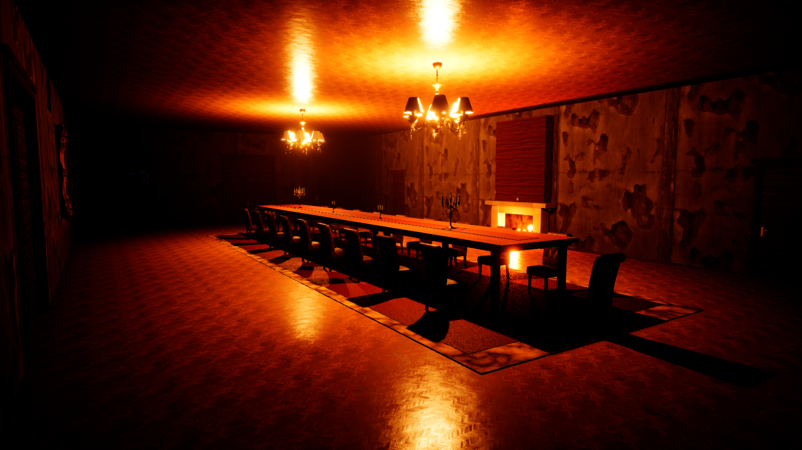
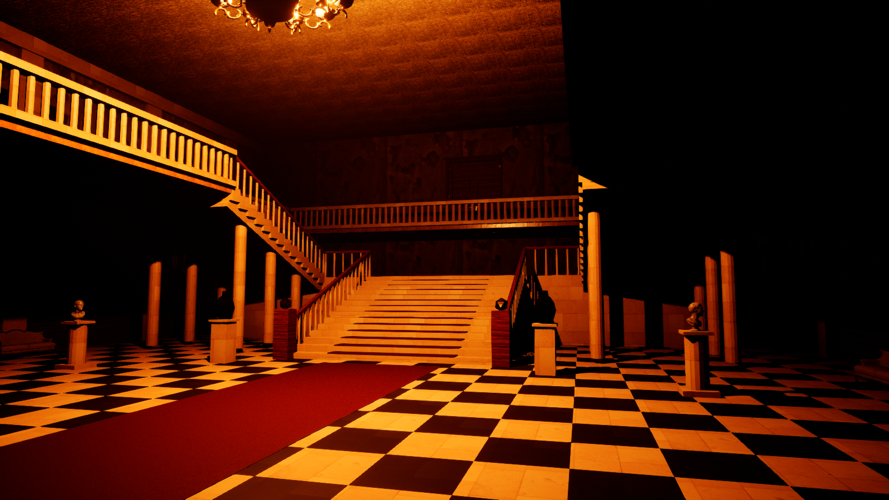
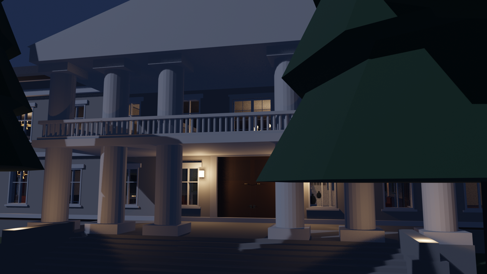
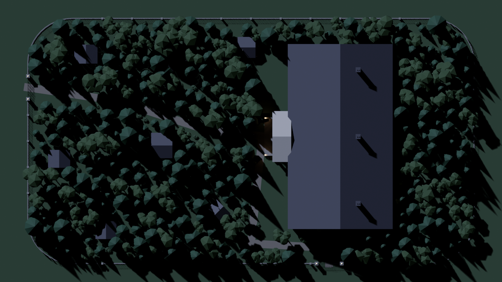

# Redwood Hollow – Slasher Korku Oyunu

Gece geçen, slasher tarzı bir korku oyunu için harita. Haritada demir çitle çevrili büyük bir bahçe, iki kapı (giriş ve kaçış), bahçeye dağılmış kulübeler ve ağaçlar, ortada da sütunlu, balkonlu, iki katlı bir malikane var.
Harita Blender'da Python ile üretiliyor ve Unreal Engine 5.8'e otomatik aktarılıyor.







## Klasörler
| Klasör / dosya | Ne işe yarar |
|---|---|
| `Unreal/RedwoodHollow/` | **UE 5.8 projesi.** `RedwoodHollow.uproject` dosyasını açıp Play'e bas (First Person karakter, WASD + fare, sol tık kapıları açar) |
| `Unreal/ue_haritayi_kur.py` | UE içinde haritayı baştan kurar: mesh import, materyaller, ağaçlar, ay ışığı, fenerler, avizeler, sis, gökyüzü, post process, PlayerStart |
| `Unreal/ue_megascans_uygula.py` | Fab'dan eklenen Megascans asset'lerini haritaya uygular (gerçek yüzeyler, ağaçlar, çimen) |
| `Blender/malikane_harita_uretici.py` | Haritayı Blender'da sıfırdan üreten script (tüm ölçüler en üstte) |
| `Blender/Cikti/Malikane_Harita.blend` | Üretilmiş Blender sahnesi |
| `Blender/Cikti/UE_Aktarim/` | UE'ye giden dosyalar: her mesh için ayrı FBX (`SM_*.fbx`) ve tüm konum, ışık ve materyalleri içeren `scene.json` |
| `Blender/Cikti/Onizlemeler/` | Blender gece render'ları (genel, giriş, iç mekan, üstten) |
| `Araclar/oyun_ekran_goruntusu.ps1` | Oyunu pencerede açıp ekran görüntüsü alır (`Gorseller/` klasörüne) |
| `Gorseller/` | UE oyun içi ekran görüntüleri |

## Harita
| Bölüm | İçerik |
|---|---|
| Bahçe | ~200 m × 110 m, 330 ağaç (3 çeşit çam, 2 çeşit meşe), 180 çalı, çakıl yollar |
| Sınır | Taş kaide üstünde mızrak uçlu siyah demir çit, her ~14 m'de taş sütun |
| Kapılar | Batı: **Giriş kapısı** (aralık), güney: **Kaçış kapısı** (kapalı). Kemerli demir kanatlar; pivot menteşede, UE'de Z ekseninde döndürülerek açılır |
| Malikane | 44 m × 80 m, 2 kat (5 m), 1,5 m kaide. Büyük merdiven, 6 dev sütun, balkon, alınlık, 5 m çift kanatlı kapı |
| Pencereler | Gerçek açıklık, çerçeve, kayıt, denizlik, lento ve yarı saydam cam |
| Giriş holü | İki kat yüksekliğinde, siyah-beyaz mermer zemin, kapının tam karşısında kırmızı halılı imparatorluk merdiveni (orta kol, sahanlık, iki yana dönen kollar), holü çevreleyen üst galeri, dev avize, ahşap lambri, pilastrlar, tablolar, vazolar |
| Odalar | Zemin kat: şömineli salon (kanepe, koltuklar, piyano, kitaplıklar, ayaklı saat), 28 kişilik yemek salonu (şamdanlar, konsollar, şömine), kütüphane. Üst kat: sayvanlı yataklı iki yatak odası (gardırop, şömine, çalışma masası), portre galerisi |
| Işık | 14 avize, 4 şömine ateşi; her pencerede kadife perde |
| Kulübeler | 7 kulübe, taş temel, camlı pencereler, aralık kapı; bazılarının içi yanıyor |
| Oyun | `PlayerStart` (giriş kapısı), `Kacis_Trigger` (kaçış kapısının dışında) |

## Haritayı değiştirip yeniden kurmak
1. `Blender/malikane_harita_uretici.py` üstündeki değerleri değiştir (harita ve malikane boyutu, kulübe listesi, ağaç sayısı), sonra depo kök klasöründen çalıştır:
   ```
   "C:\Program Files\Blender Foundation\Blender 5.3\blender.exe" -b -P Blender/malikane_harita_uretici.py -- Blender/Cikti
   ```
2. UE editöründe **Tools → Execute Python Script** ile `Unreal/ue_haritayi_kur.py` dosyasını çalıştır. Script `/Game/Malikane` klasörünü ve `/Game/Maps/Malikane` haritasını baştan kurar. Haritaya elle eklediğin aktörler silinir.

## Gerçekçi grafik (Megascans / Fab)
1. UE'de **Window → Fab** panelini aç ve Epic hesabınla giriş yap.
2. Aşağıdaki ücretsiz asset'leri ara, her birinde **Add to My Library**, sonra **Add to Project** yap (kalite: Medium ya da High):
   - Ağaçlar: *Megaplants: Norway Spruce*, *Megaplants: Baltic Pine*, *Megaplants: English Oak*, *Megaplants: Black Poplar*, *Megaplants: European Hornbeam*
   - Çimen ve çalı: Quixel *Wild Grass*, *Grass Clumps*, *Tall Grass*
   - Yüzeyler: Quixel *Roof Tiles*, *Gravel Floor*, *Mossy Brick Floor*, *Cracked Plaster Floor*
   - Hazır paketler (taş, ahşap, metal ve korku havası için): *Medieval Village Megascans Sample*, *Dark Ruins Megascans Sample*
3. **Tools → Execute Python Script** → `Unreal/ue_megascans_uygula.py`. Script asset'leri isimlerinden tanır:
   - Blockout materyallerinin yerine gerçek yüzeyleri koyar.
   - Çam ağaçlarını konifer, meşeleri yapraklı Megaplants ile değiştirir; çalıları da değiştirir.
   - Bahçeye 20.000 çimen öbeği ekler.

Haritayı `ue_haritayi_kur.py` ile yeniden kurarsan `ue_megascans_uygula.py` dosyasını da tekrar çalıştır.

## Gerçekçi grafik (Poly Haven, hesapsız)
Dokular ve modeller [Poly Haven](https://polyhaven.com)'dan (CC0) gelir:
1. Asset'leri indir (~405 MB, `Unreal/PolyHaven_Kaynak/`, git'e eklenmez):
   ```
   powershell -ExecutionPolicy Bypass -File Araclar\polyhaven_indir.ps1
   ```
2. Modelleri hazırla:
   ```
   "C:\Program Files\Blender Foundation\Blender 5.3\blender.exe" -b -P Blender/polyhaven_hazirla.py -- Unreal/PolyHaven_Kaynak
   ```
3. UE'de **Tools → Execute Python Script** ile önce `Unreal/ue_haritayi_kur.py`, sonra `Unreal/ue_polyhaven_uygula.py` dosyasını çalıştır.

Bu adımlar şunları yapar:
- PBR yüzeyler: çimen, çakıl, kale taşı, eski sıva, mermer, kayrak, ahşap, parke, paslı metal, kadife.
- Gerçek ağaçlar, çalılar ve 25.000 çimen öbeği. Ağaç, çalı ve kütüklerin içinden geçilemez.
- Gerçek avizeler ve mobilyalar: koltuk, kanepe, gotik yatak ve dolap, konsol, ayaklı saat, büst, ayna, tablo, şamdan.

`Content/PolyHaven` klasörü depoda hazır geldiği için bu adımları sadece asset'leri değiştirmek istersen tekrar çalıştırman gerekir.

## Kapılar (sol tıkla aç/kapa)
Kapıların hepsi menteşesinden açılır:
- Malikane ana kapısı ve balkon kapısı
- Tüm iç çift kanatlı kapılar
- Kulübe kapıları
- İki bahçe kapısı

Kapılar `Unreal/RedwoodHollow/Source/RedwoodHollow` içindeki C++ sınıflarıyla çalışır:
- `AMalikaneDoor`: menteşeden yumuşak dönüş; çift kanatlı kapılarda eşi de birlikte açılır. `bLocked` ile kilitlenebilir.
- `AMalikaneInteractor`: sol tıkta kameradan 3,5 m ışın atar ve bakılan kapıyı açar ya da kapatır.

Derlemek için Visual Studio'da **Game development with C++** bileşeni ve Windows SDK gerekir. Depoyu klonladıktan sonra `RedwoodHollow.uproject` dosyasını açınca UE modülü derlemeyi teklif eder. Elle derlemek için:
```
"C:\Program Files\Epic Games\UE_5.8\Engine\Build\BatchFiles\Build.bat" RedwoodHollowEditor Win64 Development -Project="<depo>\Unreal\RedwoodHollow\RedwoodHollow.uproject"
```

## Gece ayarları
`Unreal/ue_haritayi_kur.py` en üstündeki değerler: `MOON_LUX` (ay ışığı), `EXPOSURE_BIAS` (genel parlaklık), `LAMP_CD_PER_WATT` (fener ve avize gücü), `EMISSIVE_SCALE`, `FOG_DENSITY`.
Editörde de değiştirilebilir: `Gece_PostProcess` (Exposure Compensation), `Sis`, `Ay_Isigi`.

## Notlar
- Ölçek: Blender'da 1 birim = 1 m, UE'de 100 cm. FBX `FBX_SCALE_NONE` ile export ediliyor. `FBX_SCALE_UNITS` kullanılırsa UE'de her şey 100 kat küçük çıkar.
- Modeller şimdilik script'le üretilmiş sade geometri (blockout). Gerçekçi görünüm için UE içindeki Fab / Quixel Bridge'den Megascans asset'leri kullanılabilir.
- UE proje klasöründe `Content/Characters`, `Content/FirstPerson`, `Content/Input` ve `Content/LevelPrototyping` klasörleri UE 5.8 First Person şablonundan geliyor.

## Sonraki adımlar
Slasher mekanikleri: katil AI, kovalamaca, saklanma, fener, kapı açma Blueprint'leri, kaçış ekranı.
