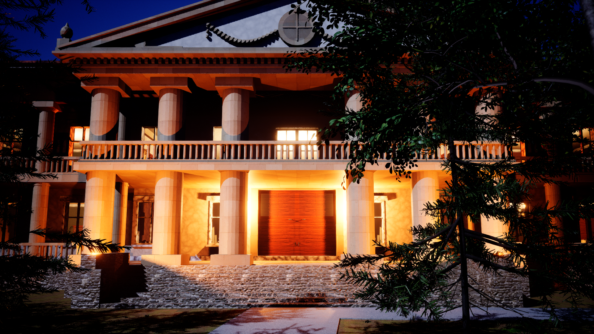
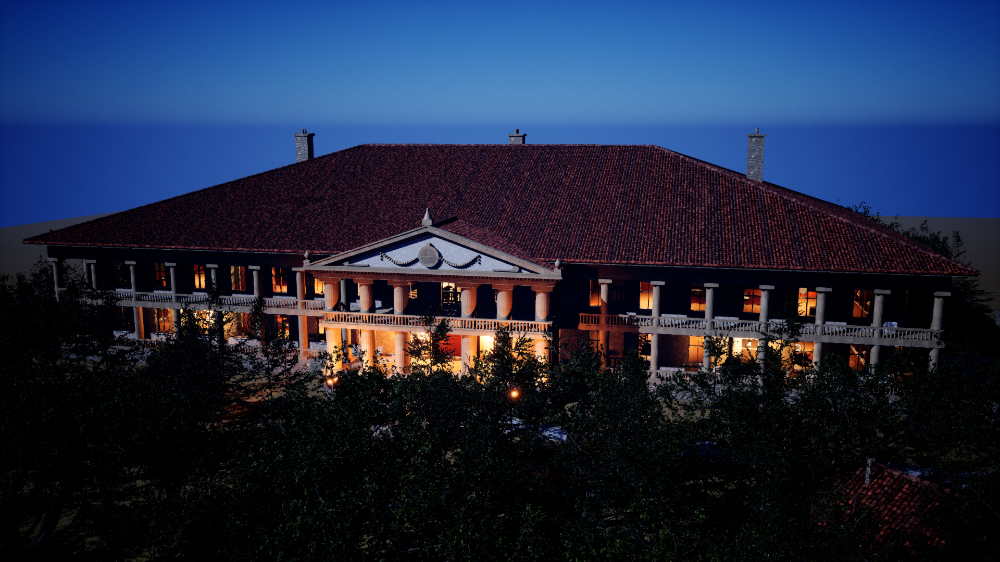
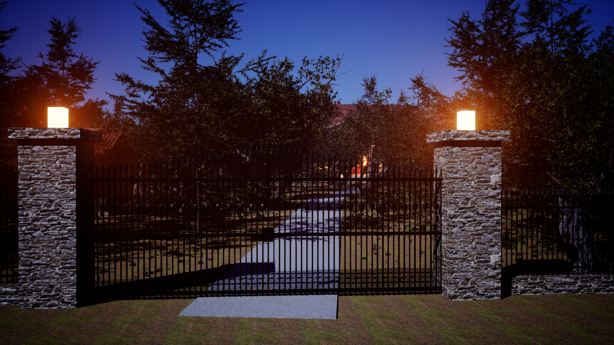

# Redwood Hollow – Harita Tasarımı
🇹🇷 Türkçe Açıklama

Bilgilendirme:

Bu harita, tamamen tek başıma, yapay zekayı bir rehber ve yardımcı araç olarak kullanarak kısıtlı boş zamanlarımda tasarlayıp geliştirmeye çalıştığım kişisel bir projedir. Yoğun bir üniversite sınavı (YKS) hazırlık sürecinde olduğum için zamanım oldukça kısıtlı; bu nedenle gözümden kaçmış olabilecek ufak hatalar veya eksiklikler için anlayış gösteren herkese şimdiden teşekkür ederim. Eğer gözden kaçırdığım büyük hatalar veya önemli sorunlar fark ederseniz lütfen beni bilgilendirin.


🇬🇧 English Description

Information:

This map is a personal project that I have been designing and developing entirely on my own in my limited spare time, using AI strictly as a guide and assisting tool. As I am currently preparing intensively for university entrance exams, my free time is very limited. Thank you in advance for your understanding regarding any minor bugs or oversights you might encounter. If you notice any major bugs or critical issues that I may have overlooked, please let me know.


Kişisel bir harita tasarımı çalışması. Oyun değil; Unreal Engine 5.8'de gezilebilen, gece geçen bir malikane haritası.

Haritada şunlar var:
- Demir çitle çevrili büyük bir bahçe ve iki bahçe kapısı.
- Bahçeye dağılmış kulübeler ve ağaçlar.
- Ortada sütunlu, balkonlu, iki katlı, saray gibi döşenmiş bir malikane.

Harita Blender'da Python ile üretiliyor ve Unreal Engine'e otomatik aktarılıyor. Haritayı gezerken kullanılan birkaç küçük etkileşim de var: kapı açma, çömelme ve dar aralıktan geçme.





| | |
|---|---|
|  |  |
|  |  |

## Haritayı gezmek
`Unreal/RedwoodHollow/RedwoodHollow.uproject` dosyasını aç ve **Play**'e bas. Kamera üçüncü şahıs, omuz üstünden. WASD ile yürünür, fareyle etrafa bakılır.

## Mekanikler
| Tuş | Mekanik | Nasıl çalışıyor |
|---|---|---|
| **Sol tık** | Kapı ve kapak açma | Baktığın kapıyı menteşesi üstünde yumuşakça açar ya da kapatır. Malikanenin ana kapısı, balkon kapısı, hol ve oda kapıları, kulübe kapıları ve yerdeki tahta kapaklar açılır. Çift kanatlı kapıların iki kanadı birlikte açılır. Kapının önünde mobilya olsa bile yakındaki kapıyı bulur. |
| **Ctrl** (basılı tut) | Çömelme | Karakter yavaşça çömelir, bırakınca yavaşça doğrulur; yürürken basınca doğrudan çömelerek yürümeye geçer. Çömelikken daha yavaş yürünür, kamera da alçalır. Yemek salonundaki uzun masanın ve çalışma masalarının altına girilebilir. Bir masanın altındayken Ctrl bırakılırsa, başının üstünde yer açılana kadar çömelik kalır. |
| **E** (basılı tut) | Dar aralıktan geçme | Dar bir aralığın önüne gelince ekranda beyaz daire içinde **E** belirir. E'ye 0,7 saniye basılı tutunca dairenin çevresindeki yeşil halka dolar ve karakter aralıktan yan yan geçer. |
| Sol tık + yer kapağı | Gizli tünel | Bir kulübenin zeminindeki tahta kapak açılınca merdivenle tünele inilir. Tünel çitin altından geçer ve bahçenin dışındaki ikinci bir kapaktan çıkar. |

## Harita
| Bölüm | İçerik |
|---|---|
| Bahçe | ~200 m × 110 m, 330 ağaç, 180 çalı, 260 öbekte ~5.700 eğreltiotu, alçak çalı ve uzun ot, 25.000 çimen öbeği, çakıl yollar. Çalıların ve otların içinden geçilebiliyor; karakter yaklaşınca kökünden ters yöne yatıyor, hafif rüzgârda da sallanıyorlar |
| Sınır | Taş kaide üstünde mızrak uçlu siyah demir çit, her ~14 m'de taş sütun |
| Bahçe kapıları | Batıda ve güneyde kemerli, çift kanatlı demir kapılar |
| Malikane | 44 m × 80 m, 2 kat, 1,5 m kaide. Büyük dış merdiven, 6 dev sütunlu giriş, balkon, krem badanalı sıva cephe, dört yana eğimli kiremit kaplı kırma çatı |
| Alınlık | Giriş sütunlarının üstünde klasik alınlık: profilli eğik ve yatay korniş, diş sırası, sıvalı iç yüzeyde göz pencere ve kabartma çelenkler, tepede ve köşelerde taş süslemeler |
| Sütunlu galeri | Malikaneyi dört yandan saran iki katlı galeri: altta mermer döşeli veranda, üstte korkuluklu balkon yolu, kaideli ve başlıklı dev sütunlar, tavana asılı demir fenerler, bahçeye inen üç merdiven. Çatı galeriyi de örtüyor |
| Giriş holü | İki kat yüksekliğinde, siyah-beyaz mermer zemin, kapının karşısında kırmızı halılı imparatorluk merdiveni, üst galeri, dev avize, ahşap lambri |
| İç mekân | Odalarda koyu ahşap lambri ve süpürgelik, üstünde ipek duvar kaplaması (kuzey kanat yeşil, güney kırmızı, doğu mavi), krem tavan, tavan pervazı ve avize göbekleri |
| Odalar | Holün iki yanındaki kanatlar her katta beşe bölünmüş: ön oda, yan oda, dış oda, giyinme odası ve banyo. Zemin kat: şömineli salon, sigara odası, yemek salonu, oturma odası. Üst kat: sayvanlı yataklı yatak odaları, çalışma odaları. Doğu kanadı üç bölüm: kütüphane ve portre galerisi. Odalar arası tek kanatlı kapılar açılıp kapanır |
| Banyolar | 4 banyo (her kanatta, iki katta): ayaklı küvet, zincirli rezervuarlı klozet, ayaklı lavabo ve ayna, karo zemin, koyu yeşil fayans lambri, küçük avize |
| Mobilya | Koltuk, kanepe, gotik yatak ve dolap, konsol, ayaklı saat, büst, ayna, tablo, şamdan; yemek ve çalışma masalarının altı çömelince girilecek yükseklikte |
| Işık | 31 avize, 11 galeri feneri, 7 şömine ateşi, her pencerede kadife perde, gece ay ışığı ve sis |
| Kulübeler | 7 kulübe: taş temel, kiremit kaplı saçaklı çatı, ahşap kalkan duvarı, camlı pencereler, açılır tahta kapı, içinde ahşap tezgahlar ve duvara sabit gaz lambaları |
| Gizli tünel | Bir kulübenin zeminindeki kapaktan inilen, çitin altından geçip dışarıda ikinci bir kapaktan çıkan ahşap destekli tünel |
| Dar aralık | Güney yatak odasında dolapların yarı kapattığı kapı; arasından yan yan geçiliyor |

## Klasörler
| Klasör / dosya | Ne işe yarar |
|---|---|
| `Unreal/RedwoodHollow/` | UE 5.8 projesi |
| `Unreal/ue_haritayi_kur.py` | UE içinde haritayı baştan kurar: mesh import, materyaller, ışıklar, sis, gökyüzü, kapılar |
| `Unreal/ue_polyhaven_uygula.py` | Poly Haven dokularını ve modellerini haritaya uygular |
| `Unreal/ue_megascans_uygula.py` | İstenirse Fab'dan eklenen Megascans asset'lerini haritaya uygular |
| `Blender/malikane_harita_uretici.py` | Haritayı Blender'da sıfırdan üreten script (ölçüler en üstte) |
| `Blender/polyhaven_hazirla.py` | Poly Haven modellerini UE için hazırlar |
| `Blender/Cikti/` | Üretilen `.blend` sahnesi ve UE'ye giden FBX + `scene.json` (önizleme render'ları yerelde kalır) |
| `Araclar/` | Poly Haven indirme, oyun penceresi ekran görüntüsü ve kamera görüntüsü script'leri (`ue_kamera_goruntuleri.py`: `dis` seti README fotoğraflarını, `odalar` seti iç mekânı çeker) |
| `Gorseller/` | README'deki fotoğraflar (UE'de SceneCapture ile çekildi) |

## Haritayı değiştirip yeniden kurmak
1. `Blender/malikane_harita_uretici.py` üstündeki değerleri değiştir, sonra depo kök klasöründen çalıştır:
   ```
   "C:\Program Files\Blender Foundation\Blender 5.3\blender.exe" -b -P Blender/malikane_harita_uretici.py -- Blender/Cikti
   ```
2. UE editöründe **Tools → Execute Python Script** ile önce `Unreal/ue_haritayi_kur.py`, sonra `Unreal/ue_polyhaven_uygula.py` dosyasını çalıştır. Bu iki script `/Game/Maps/Malikane` haritasını baştan kurar; haritaya elle eklediğin aktörler silinir.

## Dokular ve modeller
Dokular ve modeller [Poly Haven](https://polyhaven.com)'dan gelir (CC0). İşlenmiş hâlleri `Content/PolyHaven` içinde depoda hazır duruyor. Ham dosyaları yeniden indirmek için (~405 MB, git'e eklenmez):
```
powershell -ExecutionPolicy Bypass -File Araclar\polyhaven_indir.ps1
"C:\Program Files\Blender Foundation\Blender 5.3\blender.exe" -b -P Blender/polyhaven_hazirla.py -- Unreal/PolyHaven_Kaynak
```

Karakter ve animasyonlar UE 5.8'in Third Person şablonundan geliyor. Çömelme animasyonları ise motorla gelen MoverExamples eklentisinden kopyalandı ve `Config/DefaultEngine.ini` içindeki CoreRedirects ile proje iskeletine bağlandı. Animasyon blueprint'inin `DefaultSlot`'unda montaj olarak oynatılıyorlar; böylece ayakta durma, çömelme ve kalkma arasında yumuşak geçiş oluyor.

## Etkileşim kodu (C++)
`Unreal/RedwoodHollow/Source/RedwoodHollow`:
- `AMalikaneDoor`: menteşeden dönen kapı ve yer kapağı; çift kanatlar birlikte açılır.
- `AMalikaneInteractor`: sol tık, Ctrl ve E tuşları, çömelme animasyonları, omuz üstü kamera ayarı; her karede oyuncunun konumunu `MPC_Oyuncu`ya yazar (çalı ve otlar buna göre eğilir).
- `AMalikaneSqueeze`: dar aralıktan yan geçiş.
- `AMalikaneHUD`: E istemi (beyaz daire ve dolan yeşil halka).
- `UMalikaneCrouchCamera`: çömelirken kamera yüksekliğini yumuşatır.

Derlemek için Visual Studio'da **Game development with C++** bileşeni ve Windows SDK gerekir. `RedwoodHollow.uproject` açılınca UE modülü derlemeyi teklif eder. Elle derlemek için:
```
"C:\Program Files\Epic Games\UE_5.8\Engine\Build\BatchFiles\Build.bat" RedwoodHollowEditor Win64 Development -Project="<depo>\Unreal\RedwoodHollow\RedwoodHollow.uproject"
```

## Gece ayarları
`Unreal/ue_haritayi_kur.py` en üstündeki değerler: `MOON_LUX` (ay ışığı), `EXPOSURE_BIAS` (genel parlaklık), `LAMP_CD_PER_WATT` (fener gücü), `INDOOR_LIGHT_SCALE` (avize ve şömine), `FOG_DENSITY`.
Editörde de değiştirilebilir: `Gece_PostProcess`, `Sis`, `Ay_Isigi`.

## Notlar
Blender'da 1 birim = 1 m, UE'de 100 cm. FBX `FBX_SCALE_NONE` ile export ediliyor; `FBX_SCALE_UNITS` kullanılırsa UE'de her şey 100 kat küçük çıkar.
