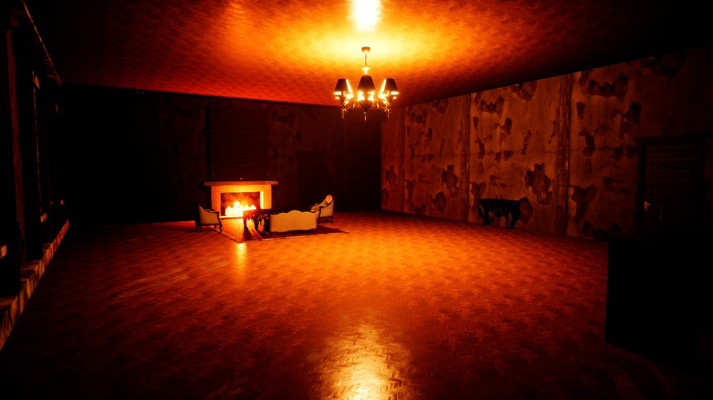
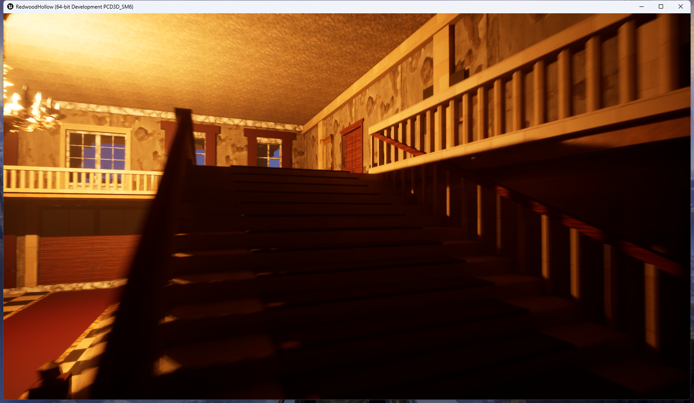

# Redwood Hollow – Harita Tasarımı

Kişisel bir harita tasarımı çalışması. Oyun değil; Unreal Engine 5.8'de gezilebilen, gece geçen bir malikane haritası.

Haritada şunlar var:
- Demir çitle çevrili büyük bir bahçe ve iki bahçe kapısı.
- Bahçeye dağılmış kulübeler ve ağaçlar.
- Ortada sütunlu, balkonlu, iki katlı, saray gibi döşenmiş bir malikane.

Harita Blender'da Python ile üretiliyor ve Unreal Engine'e otomatik aktarılıyor. Haritayı gezerken kullanılan birkaç küçük etkileşim de var: kapı açma, çömelme ve dar aralıktan geçme.






## Haritayı gezmek
`Unreal/RedwoodHollow/RedwoodHollow.uproject` dosyasını aç ve **Play**'e bas. Kamera üçüncü şahıs, omuz üstünden.

| Tuş | Ne yapar |
|---|---|
| WASD + fare | Yürü, etrafa bak |
| Sol tık | Baktığın kapıyı ya da yer kapağını aç/kapa |
| Ctrl (basılı tut) | Çömel; büyük masaların altına girilebilir |
| E (basılı tut) | Dar bir aralığın önündeyken yan yan geç |

## Harita
| Bölüm | İçerik |
|---|---|
| Bahçe | ~200 m × 110 m, 330 ağaç, 180 çalı, 25.000 çimen öbeği, çakıl yollar |
| Sınır | Taş kaide üstünde mızrak uçlu siyah demir çit, her ~14 m'de taş sütun |
| Bahçe kapıları | Batıda ve güneyde kemerli, çift kanatlı demir kapılar |
| Malikane | 44 m × 80 m, 2 kat, 1,5 m kaide. Büyük dış merdiven, 6 dev sütun, balkon, alınlık, 1,5 m saçaklı çatı |
| Giriş holü | İki kat yüksekliğinde, siyah-beyaz mermer zemin, kapının karşısında kırmızı halılı imparatorluk merdiveni, üst galeri, dev avize, ahşap lambri |
| Odalar | Holün iki yanındaki kanatlar her katta beşe bölünmüş: ön oda, yan oda, dış oda, giyinme odası ve banyo. Zemin kat: şömineli salon, sigara odası, yemek salonu, oturma odası. Üst kat: sayvanlı yataklı yatak odaları, çalışma odaları. Doğu kanadı üç bölüm: kütüphane ve portre galerisi. Odalar arası tek kanatlı kapılar açılıp kapanır |
| Banyolar | 4 banyo (her kanatta, iki katta): ayaklı küvet, zincirli rezervuarlı klozet, ayaklı lavabo ve ayna, karo zemin, koyu yeşil fayans lambri, küçük avize |
| Mobilya | Koltuk, kanepe, gotik yatak ve dolap, konsol, ayaklı saat, büst, ayna, tablo, şamdan; yemek ve çalışma masalarının altı çömelince girilecek yükseklikte |
| Işık | 31 avize, 7 şömine ateşi, her pencerede kadife perde, gece ay ışığı ve sis |
| Kulübeler | 7 kulübe: taş temel, saçaklı çatı, camlı pencereler, açılır tahta kapı, içinde ahşap tezgahlar ve duvara sabit gaz lambaları |
| Gizli tünel | Bir kulübenin zeminindeki kapaktan inilen, çitin altından geçip dışarıda ikinci bir kapaktan çıkan ahşap destekli tünel |
| Dar aralık | Güney yatak odasında dolapların yarı kapattığı kapı; arasından yan yan geçiliyor |

## Klasörler
| Klasör / dosya | Ne işe yarar |
|---|---|
| `Unreal/RedwoodHollow/` | UE 5.8 projesi |
| `Unreal/ue_haritayi_kur.py` | UE içinde haritayı baştan kurar: mesh import, materyaller, ışıklar, sis, gökyüzü, kapılar |
| `Unreal/ue_polyhaven_uygula.py` | Poly Haven dokularını ve modellerini haritaya uygular |
| `Unreal/ue_megascans_uygula.py` | İstenirse Fab'dan eklenen Megascans asset'lerini haritaya uygular |
| `Blender/malikane_harita_uretici.py` | Haritayı Blender'da sıfırdan üreten script (ölçüler en üstte) |
| `Blender/polyhaven_hazirla.py` | Poly Haven modellerini UE için hazırlar |
| `Blender/Cikti/` | Üretilen `.blend` sahnesi, önizleme render'ları ve UE'ye giden FBX + `scene.json` |
| `Araclar/` | Poly Haven indirme, ekran görüntüsü alma ve kamera görüntüsü script'leri |
| `Gorseller/` | UE ekran görüntüleri |

## Haritayı değiştirip yeniden kurmak
1. `Blender/malikane_harita_uretici.py` üstündeki değerleri değiştir, sonra depo kök klasöründen çalıştır:
   ```
   "C:\Program Files\Blender Foundation\Blender 5.3\blender.exe" -b -P Blender/malikane_harita_uretici.py -- Blender/Cikti
   ```
2. UE editöründe **Tools → Execute Python Script** ile önce `Unreal/ue_haritayi_kur.py`, sonra `Unreal/ue_polyhaven_uygula.py` dosyasını çalıştır. Bu iki script `/Game/Maps/Malikane` haritasını baştan kurar; haritaya elle eklediğin aktörler silinir.

## Dokular ve modeller
Dokular ve modeller [Poly Haven](https://polyhaven.com)'dan gelir (CC0). İşlenmiş hâlleri `Content/PolyHaven` içinde depoda hazır duruyor. Ham dosyaları yeniden indirmek için (~405 MB, git'e eklenmez):
```
powershell -ExecutionPolicy Bypass -File Araclar\polyhaven_indir.ps1
"C:\Program Files\Blender Foundation\Blender 5.3\blender.exe" -b -P Blender/polyhaven_hazirla.py -- Unreal/PolyHaven_Kaynak
```

Karakter ve animasyonlar UE 5.8'in Third Person şablonundan geliyor. Çömelme animasyonları ise motorla gelen MoverExamples eklentisinden kopyalandı ve `Config/DefaultEngine.ini` içindeki CoreRedirects ile proje iskeletine bağlandı. Animasyon blueprint'inin `DefaultSlot`'unda montaj olarak oynatılıyorlar; böylece ayakta durma, çömelme ve kalkma arasında yumuşak geçiş oluyor.

## Etkileşim kodu (C++)
`Unreal/RedwoodHollow/Source/RedwoodHollow`:
- `AMalikaneDoor`: menteşeden dönen kapı ve yer kapağı; çift kanatlar birlikte açılır.
- `AMalikaneInteractor`: sol tık, Ctrl ve E tuşları, çömelme animasyonları ve omuz üstü kamera ayarı.
- `AMalikaneSqueeze`: dar aralıktan yan geçiş.
- `AMalikaneHUD`: E istemi (beyaz daire ve dolan yeşil halka).
- `UMalikaneCrouchCamera`: çömelirken kamera yüksekliğini yumuşatır.

Derlemek için Visual Studio'da **Game development with C++** bileşeni ve Windows SDK gerekir. `RedwoodHollow.uproject` açılınca UE modülü derlemeyi teklif eder. Elle derlemek için:
```
"C:\Program Files\Epic Games\UE_5.8\Engine\Build\BatchFiles\Build.bat" RedwoodHollowEditor Win64 Development -Project="<depo>\Unreal\RedwoodHollow\RedwoodHollow.uproject"
```

## Gece ayarları
`Unreal/ue_haritayi_kur.py` en üstündeki değerler: `MOON_LUX` (ay ışığı), `EXPOSURE_BIAS` (genel parlaklık), `LAMP_CD_PER_WATT` (fener gücü), `INDOOR_LIGHT_SCALE` (avize ve şömine), `FOG_DENSITY`.
Editörde de değiştirilebilir: `Gece_PostProcess`, `Sis`, `Ay_Isigi`.

## Notlar
Blender'da 1 birim = 1 m, UE'de 100 cm. FBX `FBX_SCALE_NONE` ile export ediliyor; `FBX_SCALE_UNITS` kullanılırsa UE'de her şey 100 kat küçük çıkar.
